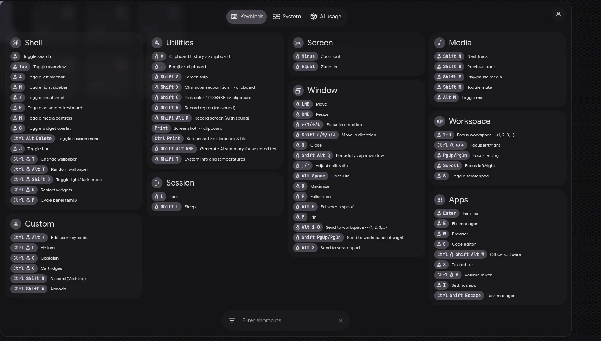
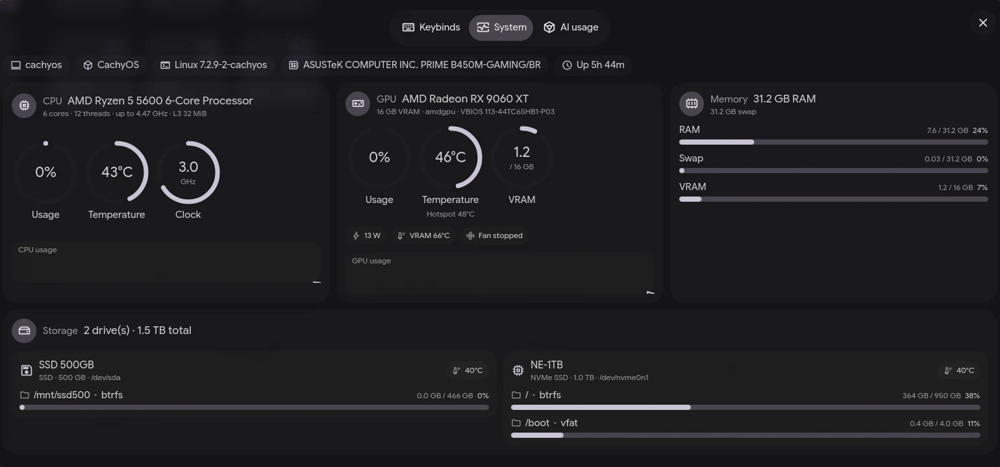
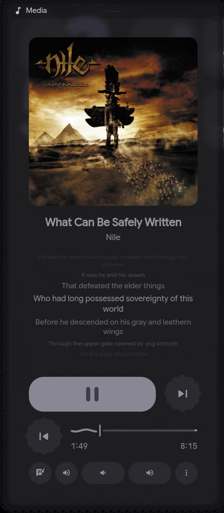
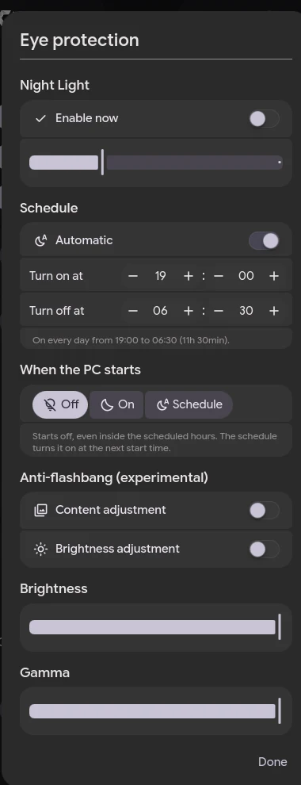
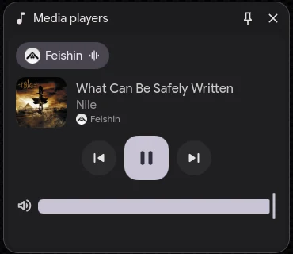
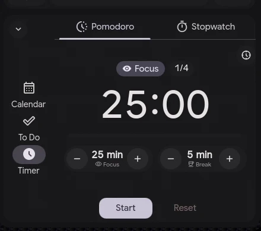
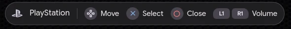
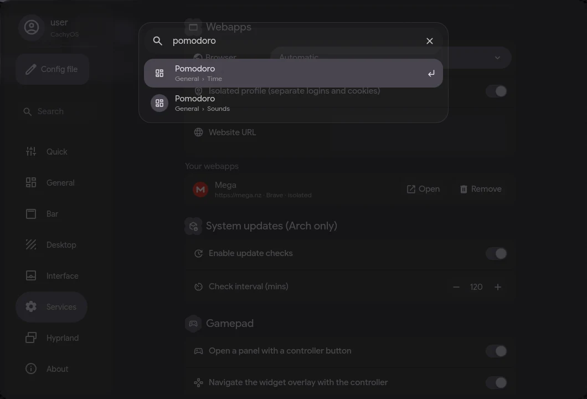
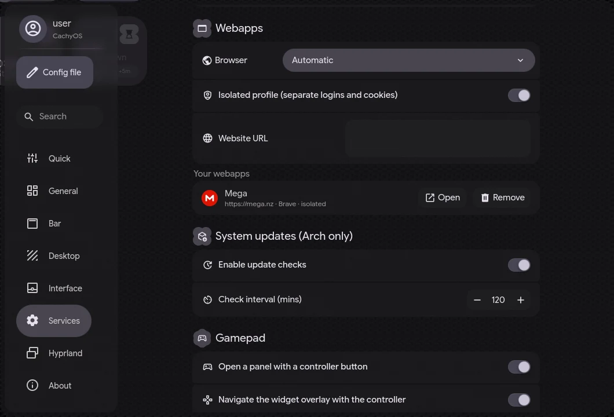

<div align="center">

# 💠 end4-pC-Custom

**A fork of [end4-pC](https://github.com/pctrade/end4-pC) by [@pctrade](https://github.com/pctrade), itself built on [illogical-impulse](https://github.com/end-4/dots-hyprland) by [@end-4](https://github.com/end-4)**
Customized and maintained by **[@jeffersonmk](https://github.com/jeffersonmk)**

[English](README.md) | [简体中文](README.zh-CN.md) | [日本語](README.ja.md) *(translations describe the upstream end4-pC)*

</div>

---

## ✨ What's different in this fork

| | |
|---|---|
| ⌨️ **Keybind cheat sheet** | `Super + /` opens a sheet (rounded window or full screen, your choice) with all your Hyprland keybinds grouped into cards (Shell, Window, Workspace, Apps, Media, your own custom binds…) with a live filter. The launcher no longer lists keybinds with `<`. |
| 🖥️ **System tab** | The cheat sheet has a second tab, **System** (`Ctrl + Tab`): CPU, GPU and memory specs, live CPU/GPU usage, temperatures, clocks, VRAM, RAM/swap and per-drive usage for every HDD/SSD/NVMe. AMD, NVIDIA and Intel; no root needed. |
| 🤖 **AI usage tab** | Third cheat sheet tab with the plan limits of **Claude** and **ChatGPT** side by side, each with its logo: usage %, reset countdowns (Claude: 5-hour session + weekly, plus per-model limits when your plan has them; ChatGPT/Codex: the plan's usage windows), extra usage / credits and Claude's weekly usage per product. Reads the local **Claude Code** (`~/.claude/.credentials.json`) and **Codex / ChatGPT desktop** (`~/.codex/auth.json`) logins; **both are off by default** — turn each one on with the button in the tab or in *Settings › Interface › Cheat sheet › AI usage tab*; until then nothing is read or sent. Tokens are only sent to `api.anthropic.com` / `chatgpt.com` and are never refreshed by the shell. Uses the same unofficial endpoints as Claude Code's `/usage` and Codex's `/status`, so it may break if they change. |
| 🎛️ **Cheat sheet styling** | *Settings › Interface › Cheat sheet*: window or fullscreen mode, Super key symbol (Arch, ⌘, Windows… Nerd Font glyphs), macOS-style modifier symbols, F-key and mouse symbols, split keycaps, font sizes. Same `cheatsheet.*` options as illogical-impulse. |
| 🌙 **Night light menu** | Right-click the night light button in the right sidebar (or *Settings › General › Night light*): set the **on/off times** of the automatic schedule, the color temperature, and what happens **when the PC starts** (off, on, or follow the schedule). Starts **off** by default. |
| 🎵 **Media players overlay** | New widget in the `Super + G` overlay (music note icon in its top bar): every media player open right now with its app icon and name; switch between them, previous / play-pause / next and per-app volume. Works with the controller too. |
| 🎮 **Gamepad support** | *Settings › Services › Gamepad*: press a controller button (default: the Xbox / PS / Nintendo *home* button) to open the widget overlay, the same as `Super + G`, or any other panel you pick. While the overlay is open you can **drive it with the controller**: d-pad / left stick moves a focus ring between every button, tab (e.g. Output/Input, CPU/RAM/Swap) and slider, the bottom button (A / ✕ / B) selects, left/right changes a focused slider (e.g. an app's volume), the right button (B / ○ / A) or Start closes it and the bumpers change the system volume. While it's open the controller works **only in the overlay** (buttons, sticks, touchpad and motion sensors are taken from the game/app behind it until you close it), and the focused game can be **paused** until you close it: separate switches for Xbox/standard controllers and for PlayStation/Nintendo ones (on by default, since emulators and Steam read those directly). A hint bar shows your controller's **brand logo** (Xbox, PlayStation or Nintendo) and its button labels. Works with USB and Bluetooth controllers plugged in at any time; outside the overlay games receive every button as usual. Off by default; needs `python-evdev` (`sudo pacman -S python-evdev`). |
| 🔍 **Search inside Settings** | A **Search** button in the Settings sidebar (or `Ctrl + F`) finds any page, section or option by keyword and jumps straight to it. |
| 📐 **Roomier Settings panel** | Bigger, better-proportioned window; nothing is cut off at the bottom of the sidebar. |
| 🧹 **Features removed** | The left-sidebar *Translator* tab, the *Screen Translator* (`Super + Shift + T`), **Google Lens** (image search button), **music recognition** (SongRec button), the Gemini clock auto-styling and the Gemini *translation generator* (welcome screen and *Settings › General › Language*) were removed. `Super + Shift + T` can open the System tab instead (see below). |
| 🖥️ **Local-only AI chat** | The *Intelligence* sidebar only talks to models running on your machine (Ollama, vLLM, or any OpenAI-compatible server on `localhost`). Online models, API keys and the `/key` command were removed. |
| 🎨 **Clock presets** | *Settings › Desktop › Cookie clock settings › Clock preset*: choose a visual style for the cookie clock — None (manual), Abstract, Anime, City/Space, Minimalist, Landscape, Plants, Person. No AI or API key needed. |
| 🍅 **Digital Pomodoro** | The Pomodoro in the right sidebar (*Timer* tab) has a **digital clock** view next to the dial: phase, cycle, big countdown and progress bar, with **−/+** buttons to change the **focus** and **break** length right there (locked while it's running). Switch with the button at the top right, or in *Settings › General › Time › Pomodoro*, which also has the long break length and cycles. |
| 🖼️ **HD album covers** | Covers are upgraded to high resolution (up to 1000–1200 px): first by asking the player itself for a bigger image (YouTube/YouTube Music, Google, Jellyfin, Navidrome), then by looking the album up on **iTunes**, **Deezer** and **MusicBrainz / Cover Art Archive**. On YouTube the real album cover is preferred over the video thumbnail (also for "Artist - Topic" / VEVO channels); a music-note icon is shown instead of a blurry crop. Downloads never show a half-loaded image. *Clear cover cache* in the player's ⋮ menu. |
| 🎤 **Better synced lyrics** | Smarter LRCLIB lookups (several artist/title/album combinations, duration matching), so tracks with multiple artists find their lyrics. Lyrics without timestamps still scroll along with the song, with a **Not synced** badge; when there are none you get *Lyrics not available* and a **Try again** button. Seeking resyncs the lyrics. |
| 🎚️ **Player selector** | The left-sidebar player has a working app selector with friendly names (no duplicates, no `playerctld`). It **follows whatever starts playing**, but an app you picked by hand stays selected while it's playing; when it closes it goes back to automatic. |
| 🌐 **Webapps, isolated** | *Settings › Services › Webapps*: choose the **browser** (Automatic, Brave, Helium, Chromium, Chrome, Vivaldi, Edge, Thorium — whatever is installed) and give every webapp its **own isolated profile** (separate logins, cookies and cache, own window), like Linux Mint's *webapp-manager*. Removing a webapp also deletes its profile. Webapp icons **follow your icon theme** (e.g. Papirus' WhatsApp/YouTube Music icons) and fall back to the site's own icon. |
| ☕ **Keep system awake, reliably** | The *Keep system awake* toggle keeps working when a monitor disconnects/reconnects (before, the PC could still suspend while the toggle looked on). |
| 📁 **Install-folder independent** | Lock screen (Niri) and *About › Update Dots* work whatever the folder is called, so this fork can live next to `end4-pC` and `ii`. |

Everything else (bar, widgets, wallpapers, Hyprland settings, presets…) comes from end4-pC and is kept in sync with it.

---

## 📸 Screenshots

### What this fork adds

<div align="center">

| ⌨️ Keybind cheat sheet (`Super + /`) |
|:---:|
|  |
| 🖥️ **System tab** — specs, usage, temperatures and drives |
|  |

| 🎵 HD cover, synced lyrics, player selector | 🌙 Night light menu |
|:---:|:---:|
|  |  |

| 🎵 Media players overlay | 🍅 Digital Pomodoro |
|:---:|:---:|
|  |  |

| 🎮 Gamepad hint bar in the overlay (controller brand + button labels) |
|:---:|
|  |

| 🔍 Search inside Settings | 🌐 Webapps: browser choice + isolated profiles |
|:---:|:---:|
|  |  |

</div>

### From end4-pC
<div align="center">

| 🎵 Lyrics | 🖼️ Online Wallpapers |
|:---:|:---:|
|  |  |
| 🪟 Desktop Widgets | 🔧 Hyprland Configs |
|  |  |
| ⚙️ Configurable Bar | ✨ And More |
|  |  |

<sub>Screenshots from upstream end4-pC.</sub>

</div>

---

## 🎨 Presets

Save your whole desktop look as a preset in **Dashboard → Presets**, export it as a ZIP or import one. You can also browse the **[end4-pCpresets](https://github.com/pctrade/end4-pCpresets)** community gallery and press **Download** to try a preset or **Install** to keep it. Uploading presets to the gallery was removed from this fork.

---

## ⚡ Installation

> [!NOTE]
> This fork lives in its own folder (`~/.config/quickshell/end4-pC-Custom`) and does **not** touch `ii` or `end4-pC`. It requires [illogical-impulse](https://github.com/end-4/dots-hyprland) to be installed, since it uses its Hyprland config, scripts and keyring entry.

```bash
cd ~/.config/quickshell/
git clone https://github.com/jeffersonmk/end4-pC-Custom.git
killall qs 2>/dev/null; qs -c end4-pC-Custom > /dev/null 2>&1 & disown
```

### 🔧 Set as your default shell

The illogical-impulse keybinds (launcher on `Super`, clipboard, emoji, etc.) talk to the shell named in `qsConfig`. If it doesn't match the running shell, they fall back to fuzzel. To use this fork for real, edit:

```bash
~/.config/hypr/hyprland/variables.lua
```

and set:

```lua
hl.env("qsConfig", "end4-pC-Custom")
```

> [!TIP]
> After saving, restart Hyprland or run `hyprctl reload`. To go back, put the previous value (`ii` or `end4-pC`) back.

### ⚙️ Settings keybind

To open the settings panel, add this to your Hyprland config:

```lua
hl.bind("SUPER + escape", hl.dsp.global("quickshell:settingsToggle"), {description = "Toggle settings"})
```

> **Note:** Settings is an overlay panel, not a regular window, so `Super + Q` won't close it. Use the same keybind or press `Escape`.

### 🖥️ System info keybind (optional)

To open the cheat sheet straight on the **System** tab (hardware, usage, temperatures), add this to `~/.config/hypr/custom/keybinds.lua`:

```lua
hl.unbind("SUPER + SHIFT + T") -- free the old screen translator bind
hl.bind("SUPER + SHIFT + T", hl.dsp.global("quickshell:systemInfoToggle"), {description = "Utilities: System info and temperatures"})
```

### 🔄 Updating

*Settings › About › Update Dots* re-downloads this repository into the folder the shell is running from and restarts it. Or manually:

```bash
cd ~/.config/quickshell/end4-pC-Custom && git pull
```

---

## ❓ FAQ

### How do I see my keybinds?

Press `Super + /`. Type in the filter at the bottom to narrow them down (by description, category or key). `Esc` clears the filter, then closes.

### How do I find a setting?

Open Settings and click **Search** in the sidebar (or press `Ctrl + F`), type a keyword (`blur`, `wallpaper`, `font`…) and press `Enter`. You can also type the keyword in the launcher (`Super`).

### How do I use the AI chat?

Install [Ollama](https://ollama.com), pull a model (e.g. `ollama pull llama3.2`), open the left sidebar and type `/refresh`. Choose a model with `/model`. Other local OpenAI-compatible servers can be added in `ai.extraModels` in `~/.config/illogical-impulse/config.json` (endpoints that aren't on `localhost` are ignored).

### Why is my SATA SSD/HDD temperature missing in the System tab?

NVMe drives report their temperature out of the box. SATA drives need the `drivetemp` kernel module: run `sudo modprobe drivetemp`, and to load it on every boot, `echo drivetemp | sudo tee /etc/modules-load.d/drivetemp.conf`.

---

## 🙏 Credits

- **[@end-4](https://github.com/end-4)**: creator of [dots-hyprland](https://github.com/end-4/dots-hyprland) / illogical-impulse 🫡
- **[@pctrade](https://github.com/pctrade)**: creator and maintainer of [end4-pC](https://github.com/pctrade/end4-pC), which this fork is based on
- **[@gh0stzk](https://github.com/gh0stzk)**: weather API integration
- **[@StarS2112](https://github.com/StarS2112)**: showcasing end4-pC
- **[@simeulinuxkaliaiwr](https://github.com/simeulinuxkaliaiwr)**: shader transitions

---

<div align="center">

Licensed under the [GPL-3.0](LICENSE), like the projects it's based on.

</div>
